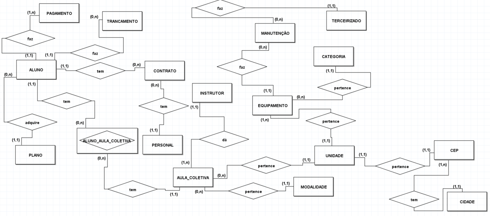
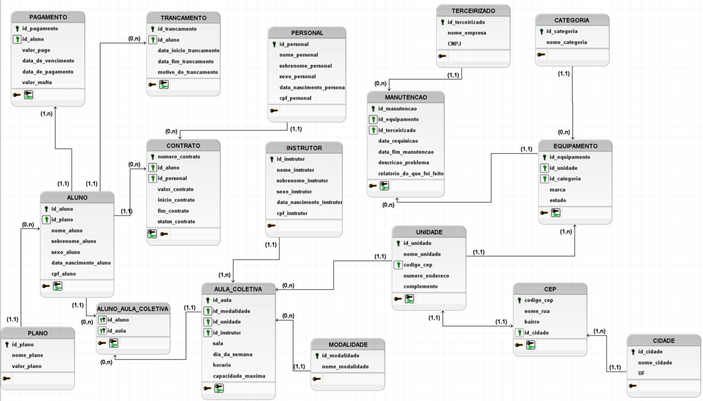

# Projeto ACADEMIA — Banco de dados relacional em SQL Server

Banco de dados de uma rede de academias com 6 unidades, modelado do zero: modelagem conceitual, lógica e física, dicionário de dados, carga de **dados fictícios**, testes das regras de negócio e consultas analíticas.

O foco do projeto é **integridade de dados**: as regras de negócio são garantidas pelo próprio banco (constraints, índices únicos filtrados e trigger), e não apenas pela aplicação.

## O que este projeto demonstra

- **Modelagem de dados:** modelos conceitual e lógico, 17 tabelas normalizadas e dicionário de dados completo.
- **Integridade no banco:** `PRIMARY KEY`, `FOREIGN KEY`, `UNIQUE`, `CHECK`, `DEFAULT`, índices únicos filtrados e uma `TRIGGER`.
- **T-SQL:** CTEs, funções de janela (`LAG`, `SUM OVER`, `ROW_NUMBER`, `DENSE_RANK`), `HAVING`, `NOT EXISTS`, funções de data e views.
- **Testes:** script que prova que o banco recusa dados inválidos e aceita os válidos, com o resultado da execução registrado.
- **Geração de dados:** script de carga em lote, aleatório, que respeita todas as regras do banco.

## Modelo de dados

**Modelo conceitual**



**Modelo lógico**



O dicionário de dados (entidades, atributos, tipos, restrições, trigger e views) está em [`03_DOCUMENTACAO/DICIONARIO_DE_DADOS.pdf`](03_DOCUMENTACAO/DICIONARIO_DE_DADOS.pdf).

**Objetos do banco:** 17 tabelas, 3 views (`VW_ALUNO_COM_IDADE`, `VW_INSTRUTOR_COM_IDADE`, `VW_PERSONAL_COM_IDADE`), 1 trigger e 3 índices únicos filtrados.

## Regras de negócio garantidas pelo banco

| Regra | Como é garantida |
|---|---|
| Pagamento atrasado tem multa maior que zero; pagamento em dia tem multa zero | `CHECK` `CK_PAGAMENTO_VALOR_MULTA_COERENTE` |
| Um aluno só pode ter **um trancamento em aberto**; o fim nunca é anterior ao início | Índice único filtrado `UX_TRANCAMENTO_ALUNO_ABERTA` + `CHECK` |
| Contrato `ATIVO` não tem data de fim; `INATIVO` exige data de fim | `CHECK` `CK_CONTRATO_STATUS_CONTRATO` |
| O mesmo par aluno + personal não pode ter dois contratos em aberto | Índice único filtrado `UX_CONTRATO_ALUNO_PERSONAL_ABERTO` |
| Manutenção concluída exige relatório; manutenção em aberto não pode ter relatório | `CHECK` `CK_MANUTENCAO_RELATORIO_OBRIGATORIO` |
| Um equipamento só pode ter uma manutenção em aberto | Índice único filtrado `UX_MANUTENCAO_EQUIPAMENTO_ABERTA` |
| Inscrições não podem ultrapassar a capacidade máxima da aula | Trigger `TGR_ALUNO_AULA_COLETIVA_CAPACIDADE` |
| Um instrutor não pode ter duas aulas no mesmo dia e horário; uma sala não pode ter duas aulas no mesmo dia e horário | `UNIQUE` em `AULA_COLETIVA` |
| Aluno com no mínimo 12 anos; instrutor e personal com no mínimo 18 | `CHECK` sobre a data de nascimento |
| CPF e CNPJ só com dígitos, no tamanho correto e únicos | `CHECK` + `UNIQUE` |
| Planos, modalidades, unidades, dias da semana, UF e estado do equipamento restritos a listas válidas | `CHECK` |

A idade não é gravada: o banco guarda a **data de nascimento**, e a idade é calculada pelas views (anos completos, descontando 1 se o aniversário do ano ainda não ocorreu).

## Como executar

**Requisitos:** SQL Server 2016 ou superior (desenvolvido e testado no SQL Server 2025 Developer, com SSMS 22).

Execute os scripts da pasta [`01_SQL/`](01_SQL/) **nesta ordem**, cada um inteiro:

1. [`01_CRIACAO.sql`](01_SQL/01_CRIACAO.sql): cria o banco `ACADEMIA`, as tabelas, os índices, as chaves estrangeiras, a trigger e as views. Se o banco já existir, apague-o antes.
2. [`02_DADOS.sql`](01_SQL/02_DADOS.sql): popula o banco com dados fictícios, em uma única transação (se algo falhar, nada é gravado). Para repetir, apague e recrie o banco.
3. [`03_TESTES_CONSTRAINTS.sql`](01_SQL/03_TESTES_CONSTRAINTS.sql): roda os testes de regras e imprime `OK` ou `FALHOU` na aba *Mensagens*. Todos terminam em `ROLLBACK` e não alteram os dados.
4. [`04_CONSULTAS.sql`](01_SQL/04_CONSULTAS.sql): consultas analíticas sobre os dados gerados.

## Dados fictícios

O `02_DADOS.sql` gera, por padrão (parâmetros no topo do script):

| Tabela | Quantidade |
|---|---|
| Alunos | 1.000 |
| Instrutores / Personais | 24 / 40 |
| Unidades / Cidades | 6 / 4 |
| Aulas coletivas | 288 (6 unidades × 2 salas × 6 dias × 4 horários) |
| Equipamentos | 360 (60 por unidade) |
| Trancamentos | 100 (85 encerrados e 15 em aberto) |
| Contratos com personal | 200 (60 ativos e 140 encerrados) |
| Manutenções | 215 (200 concluídas e 15 em aberto) |
| Pagamentos | alguns milhares (últimos 12 meses, conforme o período de cada plano; ~75% em dia e ~25% com atraso, com multa de 2%) |

Todos os nomes, CPFs e CNPJs são inventados e seguem um padrão sintético. **Nenhum dado pertence a pessoas ou empresas reais.**

> **Os dados são sorteados (`NEWID()`) e as datas são relativas à data de execução.** Por isso, os números retornados pelas consultas mudam a cada carga e não vão coincidir exatamente entre execuções.

## Testes

O `03_TESTES_CONSTRAINTS.sql` tem **16 testes**, e todos passaram. O resultado completo da execução está em [`01_SQL/Resultado_dos_testes.txt`](01_SQL/Resultado_dos_testes.txt).

Os testes cobrem as regras de negócio (multa, trancamento, contrato, manutenção, capacidade e idade) e uma amostra de cada tipo de restrição. Eles verificam os dois lados: o que deve ser **recusado** e o que deve ser **aceito** (por exemplo, o limite exato dos 12 anos e um trancamento em aberto convivendo com um encerrado).

**Não cobertos (por amostragem):** CPF, conflito de horário do instrutor, chaves estrangeiras, domínios (plano e dia da semana), `DEFAULT` do trancamento e idade mínima de instrutor e personal. São variações de padrões já demonstrados.

## Consultas

| # | Pergunta de negócio | Técnicas |
|---|---|---|
| 1 | Quantos alunos há em cada plano e qual a participação percentual de cada um? | `JOIN`, `GROUP BY`, CTE |
| 2 | Quantas aulas existem por unidade e modalidade, e qual a capacidade total? | vários `JOIN`s, `GROUP BY` |
| 3 | Qual o faturamento e o total de multas por mês nos últimos 12 meses? | funções de data, `GROUP BY` |
| 4 | Qual a taxa de ocupação de cada aula e quais as 10 mais e as 10 menos lotadas? | CTE, `ROW_NUMBER`, `UNION ALL` |
| 5 | Quais equipamentos estão `RUIM` ou `QUEBRADO` e sem manutenção em aberto? | `NOT EXISTS` |
| 6 | Qual o faturamento mensal, o acumulado e a variação percentual sobre o mês anterior? | `LAG`, `SUM OVER` |
| 7 | Qual o ranking de instrutores por alunos inscritos, reiniciando a cada unidade? | `DENSE_RANK`, `PARTITION BY` |
| 8 | Quais alunos tiveram 3 ou mais pagamentos em atraso nos últimos 12 meses e quanto pagaram de multa? | CTE, `HAVING` |

**Janela de "últimos 12 meses" (consultas 3 e 8):** 12 meses-calendário, ancorados em `MAX(data_de_pagamento)`. O mês mais recente pode estar incompleto.

## Decisões de modelagem e limitações conhecidas

- **Listas fixas em `CHECK`** (planos, modalidades, unidades): simples e seguras para este escopo, mas cadastrar um novo plano ou unidade exigiria alterar a constraint.
- **`PAGAMENTO` registra apenas pagamentos realizados** (`DATA_DE_PAGAMENTO` é obrigatória). O modelo permite analisar atraso e multa, mas não inadimplência (cobranças em aberto).
- **`ALUNO` não tem data de matrícula nem status**, o que impede análises de retenção e cancelamento.
- **Contratos com personal não têm pagamentos próprios:** a receita de personal só pode ser lida de `VALOR_CONTRATO`.
- **CPF e CNPJ validam apenas o formato** (dígitos e tamanho), não os dígitos verificadores.

## Estrutura do repositório

```
projeto_academia/
├── README.md
├── 01_SQL/
│   ├── 01_CRIACAO.sql
│   ├── 02_DADOS.sql
│   ├── 03_TESTES_CONSTRAINTS.sql
│   ├── 04_CONSULTAS.sql
│   └── Resultado_dos_testes.txt
├── 02_DIAGRAMAS/
│   ├── MODELAGEM_CONCEITUAL.png
│   └── MODELAGEM_LOGICO.png
└── 03_DOCUMENTACAO/
    └── DICIONARIO_DE_DADOS.pdf
```

## Autor

**Estêvão** — LinkedIn: <https://www.linkedin.com/in/estevao-tannus-barbosa/>